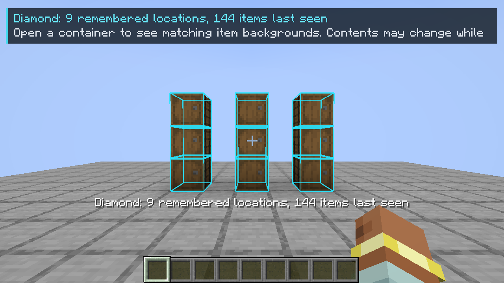
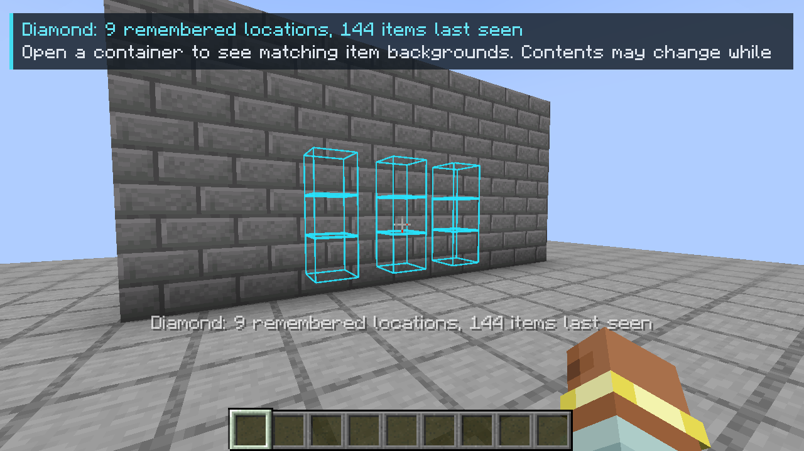
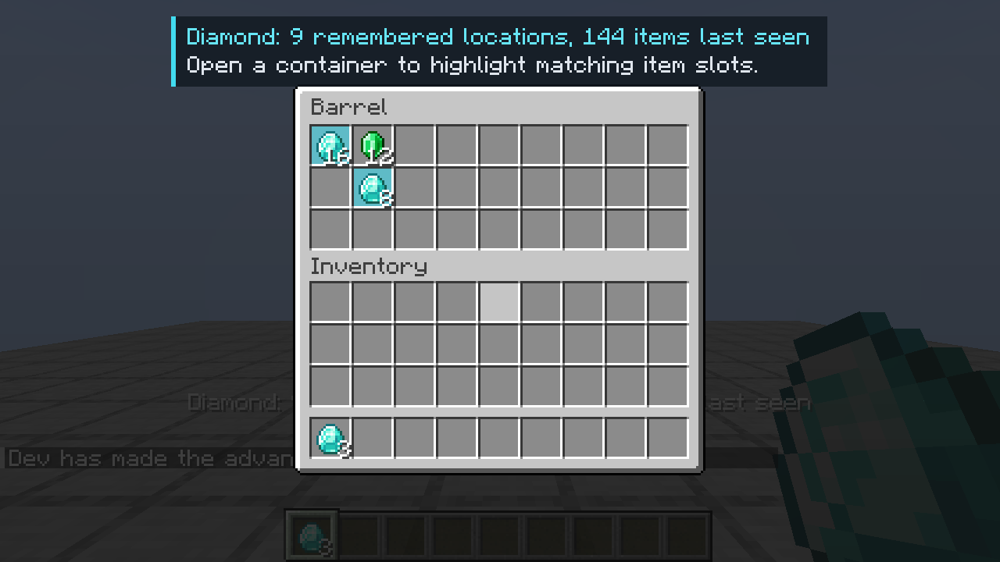

# Find Me Clientside


A Forge **Minecraft 1.20.1 / Java 17** client-only locator for items, fluids, and placed blocks, inspired by
[Buuz135's FindMe](https://github.com/Buuz135/FindMe/tree/1.20) and GTNH's
[FindIt](https://github.com/GTNewHorizons/FindIt).
No server installation, server plugin, Architectury, JEI, or other library mod is required.
[EMI](https://github.com/emilyploszaj/emi) and [AE2](https://github.com/AppliedEnergistics/Applied-Energistics-2) are optional.

[Download releases](https://github.com/Flurben/find-me-clientside/releases) ·
[Report a bug](https://github.com/Flurben/find-me-clientside/issues) ·
[AI disclosure](AI_DISCLOSURE.md)





## Install and use

1. Install Forge for Minecraft **1.20.1** (Forge **47.1 or newer in the 47.x series**).
2. Put `findmeclientside-forge-1.20.1-1.1.0.jar` from `build/libs` in your game's `mods` folder.
3. Join a server or singleplayer world and **open the containers you want remembered**.
4. Hover an inventory item or an EMI item and press **Y** to find where it is stored, or **Shift+Y** to
   find where it is placed as a block. In the world, both search your held item (main hand, then
   offhand). Both bindings are configurable under Controls → Find Me Clientside.
5. Results are outlined through walls: **cyan** for containers and tanks, **amber** for placed blocks,
   and **violet** for AE2 terminals whose network holds the item. A compact message sums them up, for
   example `Diamond: ×64 in 3 containers · ×1,024 in ME · 2 placed`; its size and position are
   configurable. Open a container during the search to highlight the backgrounds of matching item
   slots in cyan; the item icons and counts stay fully visible.

The inventory/recipe screen closes after a successful search by default. Failed searches leave it open.
Typing into the EMI search box or a vanilla text field does not trigger a search.
EMI item-list, favorite, recipe, and ingredient hovers work, including slots inside EMI's recipe
and recipe tree screens. Multi-item ingredients search all item alternatives. Fluids can be searched by
hovering them in EMI or in an AE2 terminal; a filled bucket, cell, or jug also searches for its fluid.

### What it finds

- **Containers you have opened**, from a remembered snapshot of their slots and tanks. Opening a block
  records its fluid tanks as well, including GregTech fluid hatches and drums that only sync while open.
- **Loaded blocks whose contents the server syncs to clients**, read live without opening them: GregTech
  super/quantum chests and tanks, GregTech machine and bus inventories, TerraFirmaCraft barrels, and any
  other mod that syncs its Forge item or fluid capability. These replace an older snapshot of the block.
- **Placed blocks** (Shift+Y) matching the searched block item or fluid, such as a misplaced machine or
  an oil spring, in loaded chunks. Only fluid source blocks count. The nearest 512 are outlined in amber.
  Chunks are scanned nearest first within a small per-tick time budget, so a search never stalls the game.
- **AE2 networks**, items and fluids alike, viewed through a terminal block or a linked wireless terminal.
  A terminal block is outlined itself; a wireless terminal's network is outlined at the Wireless Access
  Point it is linked to, which the terminal item records. The network is read from AE2's own terminal
  data when the terminal closes, so tracking costs nothing per tick, and large networks are converted on
  a background thread. While a terminal is open, its live contents are searched.

### Block search blacklist

Shift+Y skips blacklisted blocks. **Mods → Find Me Clientside → Config → Block search blacklist** lists
every block: type to search by name or ID, use `@mod` to filter by mod, and show all, excluded, or searched
blocks. Click a block to toggle it.

The default list covers natural terrain from every mod: stone, soil, sand, gravel, ores, plants, leaves,
logs, ice, and placed water and lava (including modded waters). It uses block tags and plant/fluid block
types, never excludes blocks with block entities (machines) or storage blocks, and leaves other fluids such
as oil searchable. It is generated on joining a world, because tags are only available then, and again only
when the mod list changes. Your own changes are kept separately and survive regeneration; **Reset to
defaults** discards them. The list is stored in `config/findmeclientside-block-blacklist.json`.

### The client-only limit

**An unmodified server does not send most unopened container contents to the client.** This mod searches
remembered snapshots of containers you have opened, plus the contents that mods sync to clients anyway;
it cannot perform FindMe's or FindIt's live server-side scan or remotely pull items. Another player, hopper, or machine can change a closed
container without your client being told. Reopen it to refresh the cache. Counts describe your latest
observation, not a live guarantee.

Normal chests, double chests, barrels, shulker boxes, ender chests, hoppers, dispensers, droppers,
furnaces, and other block inventories exposing ordinary menu slots can be remembered. Double chests
are recorded once from either half. Known ender-chest access points share this player's latest
contents; totals do not count those shared items repeatedly. Player inventory slots are excluded.
Entity inventories (minecarts, boats, horses), item-opened backpacks, and server-opened virtual menus
without an associated block interaction are not recorded. AE2 terminal grids and filter ghost slots are
never attributed to the block. Other mods' ghost slots and menus with unusual synchronization may need
dedicated integration.

AE2 limits: an unlinked wireless terminal has no access point to outline, so its network is searched only
while open. A client cannot tell which network a terminal block belongs to, so other terminals on the same
network are not outlined, and the message reports the largest remembered network rather than adding
terminals together.

Only your current dimension and the configured radius are searched. Loaded blocks that no longer
match the remembered block type are discarded. An unloaded location or same-type replacement may
remain stale until reopened. A server with several worlds behind the same address **and dimension
ID** cannot be distinguished reliably by a pure client; use `/findmeclient clear` after such switches
or a world reset. Different server addresses, singleplayer save paths, player UUIDs, and dimensions
are kept separate.

## Configuration and cache

The first launch creates `config/findmeclientside-client.toml` in the game directory. The same
options can be changed in game: **Mods → Find Me Clientside → Config**. Mod list replacements that use
Forge's config button, such as Catalogue, open the same screen.

| Option | Default | Purpose |
| --- | --- | --- |
| `search.radius` | 64 | Maximum distance in blocks (1–512) |
| `search.highlightSeconds` | 12 | Duration of outlines, message, and item-slot backgrounds |
| `search.matchNbt` | false | Require exact item NBT, including damage/enchantments |
| `search.closeScreenOnSuccess` | true | Close inventory/recipe screens to see markers |
| `search.loadedInventories` | true | Read client-synced contents of loaded blocks without opening them |
| `cache.persist` | true | Load/save remembered contents between sessions |
| `cache.maxContainers` | 4096 | Maximum remembered inventories per server/world and player |
| `cache.maxAgeDays` | 30 | Expire old observations |
| `hud.scale` | 100 | Message size in percent (50–200) |
| `hud.x` | 50 | Message position: 0 = left edge, 50 = center, 100 = right edge |
| `hud.y` | 0 | Message position: 0 = top edge, 100 = bottom edge |

Persistent cache files live in `<game directory>/findmeclientside/`, with filenames hashed from the
server address or singleplayer save path plus player UUID. Files contain container positions and
item data in readable JSON. Changes save in the background about every five seconds and on disconnect, using atomic
replacement where supported. Unreadable files are preserved with an `.unreadable-...` suffix.
AE2 networks are kept in a separate `.networks.json` file, so a large network is rewritten only when a
terminal closes, not every time a chest changes.
Disabling persistence ignores existing files; it does not erase them. Restart after changing that option.

Client commands (handled locally):

- `/findmeclient stats` — remembered container count, integration, and search radius.
- `/findmeclient clear` — erase the current server/world and player's remembered contents.

You can assign a separate **Clear search highlights** key in Controls. It removes outlines and item-slot
backgrounds. Slot backgrounds apply to the container's own slots, update as items move, and use the
same NBT setting and EMI item alternatives as the search. A new search replaces the highlighted item;
expiry, clearing, a dimension change, or disconnect removes the highlights.

## Build

Use a **JDK 17** installation and the included Gradle wrapper:

```powershell
.\gradlew.bat build
```

The distributable, reobfuscated mod is `build/libs/findmeclientside-forge-1.20.1-1.1.0.jar`.
ForgeGradle, Forge 47.3.0, Mixin, EMI 1.1.24+1.20.1, and AE2 15.4.10 are pinned for development.
EMI is a compile-only API plus a development runtime dependency, and AE2 is compile-only; neither is
**bundled** into the mod. Their integration classes load only when that mod is installed.

```powershell
.\gradlew.bat runClient                  # development game with EMI
.\gradlew.bat runClient -PwithoutEmi     # verify the game without EMI
.\gradlew.bat test                       # cache and persistence regression tests
```

Implementation: a client-only Mixin observes vanilla's initial `AbstractContainerMenu.initializeContents`
after the server data is applied. Forge interaction events associate the menu with the clicked block.
Client ticks refresh the observed menu while it is open. No custom networking channel or search
request packet is registered. The mod accepts servers that do not advertise it and initializes no
client handlers on a dedicated server. Marker rendering is capped at 256 containers and 512 placed
blocks per search.
Outlines render during Forge's `AFTER_PARTICLES` stage with the world camera transform and the
particles render target, including Fabulous graphics.

## Credits and license

Inspired by **FindMe by Buuz135** (CC0-1.0); this is an independent client-cache implementation with a
different mod ID, not an official FindMe release. Distributed under **CC0-1.0**; see [LICENSE](LICENSE).
The Gradle wrapper retains its own Apache 2.0 notices.
The package-search icon is from Lucide under ISC; see [third-party notices](THIRD_PARTY_NOTICES.md).
Maintained by [Flurben](https://github.com/Flurben). The code and documentation were substantially
generated with Codex; see [AI_DISCLOSURE.md](AI_DISCLOSURE.md).
